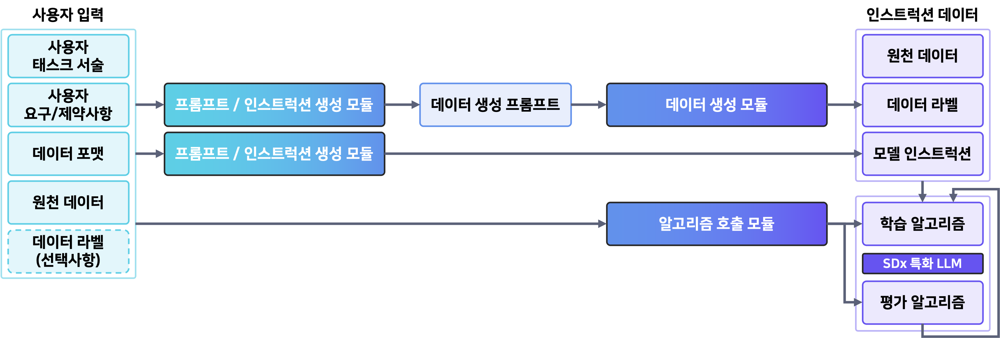
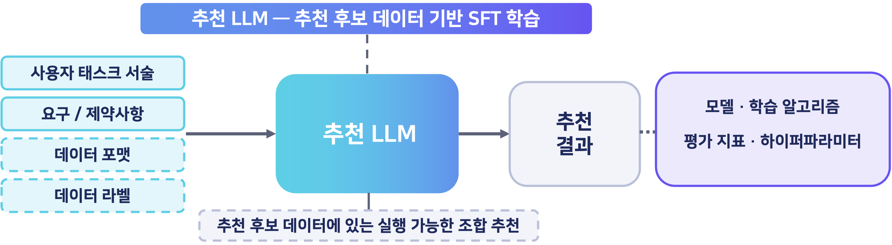
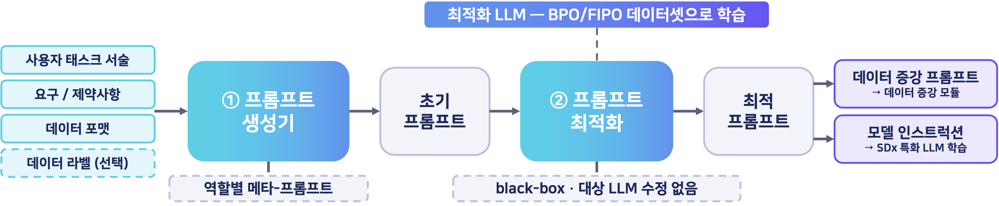
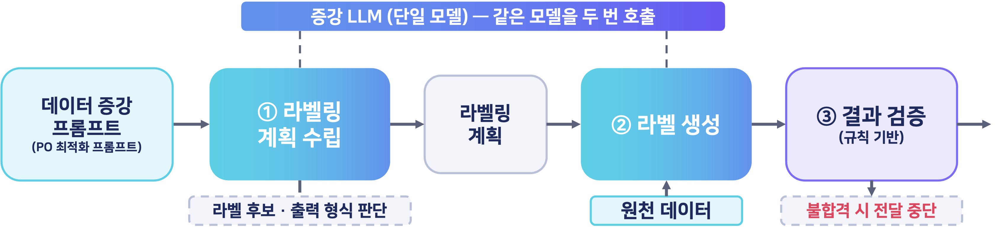

# TANGO2 Requirement-Driven LLM 학습 오케스트레이션: AR · PO · DA

## 1. 개요

사용자가 **작업 설명**과 **요구/제약사항**(보유 GPU · 언어 · 데이터 등)을 자연어로 적으면, 세 모듈이 LLM 학습에 필요한 것을 자동으로 준비합니다. 전문 지식 없이도 요구에 맞는 LLM 학습을 시작할 수 있게 하는 것이 목표입니다.

| 모듈 | 역할 | 플랫폼이 받는 결과 |
|---|---|---|
| **AR** (Algorithm Recommend) | 작업 · 환경에 맞는 모델 / 학습 알고리즘 / 평가 지표 / 하이퍼파라미터 추천 | 추천 JSON |
| **PO** (Prompt Optimization) | 데이터 증강 프롬프트 · 학습 인스트럭션 생성 및 최적화 | 최적화된 프롬프트 |
| **DA** (Data Augmentation) | PO 프롬프트대로 원천 데이터에 라벨 생성 · 검증 | (원천 데이터, 라벨) |



세 모듈은 독립된 REST 서비스(Docker 컨테이너)이며 플랫폼은 4절의 API로만 접근합니다. 현재 범위는 추천 JSON · 프롬프트 · 라벨링된 학습 데이터 생성까지이고, 실제 LLM 학습 · 평가는 플랫폼의 후속 단계입니다.
AR 웹 데모 화면: [figure/ar_demo_screen.png](figure/ar_demo_screen.png).

## 2. 디렉터리 구조

```
ETRI/
├── README.md          이 문서
├── setup.sh                 통합 설치 스크립트 (한 번에 빌드 · 기동)
├── figure/                  문서 그림 (total_framework, ar/po/da_pipeline, ar_demo_screen.png)
│
├── ar-module/               AR: 알고리즘 추천 (포트 8004)
│   ├── algorithm_recommend/   stage1~4 (학습 데이터 생성) · revision · recommender (train / infer / demo)
│   ├── resources/             후보 목록, 검수 완료 요청문
│   ├── data/                  SFT 학습 데이터
│   ├── checkpoints/           번들 LoRA checkpoint (gemma4-lora-final)
│   ├── artifacts/             추론 결과 · 로그 (생성됨)
│   ├── scripts/ · examples/ · tests/ · docs/
│   └── Dockerfile · docker-compose.yml · .env.example · README.md
│
├── prompt-module/           PO: 프롬프트 생성 · 최적화 (포트 8000)
│   ├── app/                   main.py (API) · pipeline/ (생성 · 선택 · 최적화) · llm/ (백엔드)
│   ├── templates/             meta_prompt.j2 · confidence_prompt.j2 · optimizer_prompt.j2
│   ├── examples/ · tests/
│   └── Dockerfile · docker-compose.yml · .env.example · README.md
│
└── da-module/               DA: 데이터 증강 · 라벨링 (포트 8002, 데모 수신기 8003)
    ├── app/                   main.py (API) · labeling.py (계획 · 검증) · llm.py (백엔드)
    ├── examples/              request_*.json · receiver.py (데모 수신기)
    └── Dockerfile · docker-compose.yml · .env.example · README.md
```

## 3. 설치

**사전 준비**: NVIDIA 드라이버 570 이상, Docker Engine + Compose v2, NVIDIA Container Toolkit, Docker 실행 권한(`docker` 그룹 또는 sudo). 베이스 모델은 호스트 Hugging Face 캐시에 미리 받아 둡니다(컨테이너는 오프라인 동작).

```bash
huggingface-cli login && huggingface-cli download google/gemma-4-E4B-it
```

**설치 · 기동 (명령어 하나)**

```bash
bash setup.sh
```

환경 점검 → 모듈별 `.env` 생성 → 모델 캐시 경로 기록 → 세 이미지 빌드 → PO · DA · AR 컨테이너 기동까지 한 번에 실행합니다. 모델은 첫 요청 때 GPU에 로딩되므로 첫 호출은 1~3분 걸립니다.

| 서비스 | 주소 | 상태 확인 |
|---|---|---|
| AR | http://localhost:8004 | `GET /api/status` |
| PO | http://localhost:8000 (`/docs`) | `GET /health` |
| DA | http://localhost:8002 (`/docs`) | `GET /health` |
| DA 데모 수신기 | http://localhost:8003 | `GET /last` |

**설치 후 확인할 설정** (`<모듈>/.env`, 변경 후 `docker compose --profile gpu up -d`로 재생성)

- GPU: 세 모듈 모두 기본 GPU 0. 동시 실행 시 메모리(모델당 9~16GB)가 부족하면 `AR_GPU_ID`, `DA_GPU_ID`, PO compose의 `device_ids`로 나눕니다.
- 모델: PO는 `PM_GENERATOR_MODEL` / `PM_OPTIMIZER_MODEL` / `PM_OPTIMIZER_ADAPTER`, DA는 `DA_MODEL`. 캐시 경로(`HF_CACHE`, `DA_MODELS_DIR`)는 스크립트가 기록합니다.
- `DA_DOWNSTREAM_URL`: DA가 라벨 결과를 보낼 플랫폼 API 주소(4.4절). 기본은 데모 수신기입니다.

기타: 빌드만 하려면 `bash setup.sh --no-up`, GPU 없이 API 흐름만 보려면 `--mock`, 코드 변경 후에는 모듈 디렉터리에서 `docker compose --profile gpu up --build -d`.

## 4. TANGO 플랫폼 연동 API

플랫폼은 세 가지 호출과 하나의 수신 API만 다룹니다.

| # | 목적 | 호출 | 입력 | 출력 |
|---|---|---|---|---|
| 4.1 | 알고리즘 추천 | `POST :8004/api/recommend` → `GET :8004/api/jobs/{job_id}` | 작업 설명 + 요구/제약사항 | 추천 JSON (`label_2`) |
| 4.2 | 프롬프트 생성 | `POST :8000/v1/prompts/generate` | 작업 설명 + 요구/제약사항 + 프롬프트 목적 + 데이터 정보 | `optimized_prompt`, `request_id` |
| 4.3 | 데이터 라벨 생성 | `POST :8002/v1/labels/generate` (원천 데이터 1건마다) | `optimized_prompt` + 원천 데이터 1건 | (원천 데이터, 라벨) → 4.4로 전달 |
| 4.4 | 라벨 결과 수신 | 플랫폼이 제공, DA가 `DA_DOWNSTREAM_URL`로 POST | DA의 `result` | HTTP 2xx |

**사용자 입력** — 공통 사용자 입력(`task_description`, `requirements`, `data_format`, `data_schema`, `data_label`)은 AR · PO가 필드명 · 검증 규칙이 같고 모르는 필드는 무시하므로, 같은 본문을 두 모듈에 그대로 보내도 됩니다(AR은 앞의 두 필드만 사용). `prompt_objective`는 사용자가 아니라 플랫폼이 넣는 시스템 입력입니다.

| 입력 | AR | PO | DA |
|---|---|---|---|
| 작업(태스크) 설명 | `task_description` | `task_description` | — |
| 요구/제약사항 | `requirements` | `requirements` | — |
| 데이터 형식 · 스키마 · 라벨(선택) | (무시) | `data_format`, `data_schema`, `data_label` | — |
| 프롬프트 목적 (시스템 입력) | — | `prompt_objective` | — |
| PO 결과 · 원천 데이터 1건 | — | — | `optimized_prompt`, `po_request_id`, `raw_data` |

### 4.1 알고리즘 추천 (AR)

비동기. 작업을 등록하고 `state`가 `completed`가 될 때까지 조회합니다. 동시에 1건만 처리합니다.

```json
POST /api/recommend
{
  "task_description": "한국어 보고서의 핵심 내용을 요약하는 모델을 학습하고 싶어요.",
  "requirements": "5090 그래픽 카드 환경이고 보고서는 5페이지 정도입니다."
}
→ 202 {"job_id": "3f9c..."}

GET /api/jobs/{job_id}
→ {
  "state": "completed",                       // queued → loading → generating → completed | failed
  "result": {
    "valid": true, "errors": [],
    "label_2": {
      "recommendation": {
        "model": "Qwen/Qwen3-4B", "algorithm": "QLoRA", "evaluation_metric": "BERTScore",
        "hyperparameters": {"learning_rate": 0.0001, "num_train_epochs": 3, "lora_r": 8, "...": "..."},
        "training_plan": {"...": "학습 · 동결 · 미사용 모듈"},
        "backend_requirements": {"max_seq_length": 2048, "...": "실행 시 확인 항목"},
        "recommendation_reason": "...", "parameter_rationale": "..."
      },
      "thinking": {"recommended": false},
      "recommendation_assumptions": {"gpu_capacity": {"value_gb": 12}}
    },
    "finished": true
  }
}
```

- 두 필드 모두 필수(1~20,000자), `<USER_` 태그 포함 시 422. 라벨 · 하이퍼파라미터 · GPU 용량 같은 정답은 요청문에 쓰지 않습니다.
- `result.label_2.recommendation`이 플랫폼이 쓰는 추천 본체입니다. `valid`/`errors`는 JSON 구조 · 후보 목록 검사일 뿐 학습 성공을 보장하지 않습니다. `finished=false`면 출력이 잘린 것입니다.
- 상태 코드: 422 입력 오류 · 503 모델 미준비 · 409 다른 작업 진행 중 · 404 모르는 `job_id`(메모리에 최근 50건만 보관). 생성 실패는 `state=failed`와 `message`.
- `GET /api/jobs/{job_id}/download`는 같은 `result`를 파일로, `GET /api/status`는 헬스체크.

AR 파이프라인: 추천 후보 데이터로 SFT 학습한 추천 LLM이 사용자 입력에서 실행 가능한 조합을 추천합니다.



### 4.2 프롬프트 생성 (PO)

동기. 모델 호출에 수십 초가 걸리므로 타임아웃을 600초 정도로 둡니다.

```json
POST /v1/prompts/generate
{
  "task_description": "해상상황묘사: 해상 이미지와 선박 센서값으로 자선의 현재 상황을 자연어로 서술한다.",
  "requirements": "한국어 3~5문장. 충돌 위험 선박이 있으면 명시한다.",
  "prompt_objective": "주어진 태스크와 데이터에 적합한 데이터 증강 프롬프트를 만들어야 해. ...",
  "data_format": "image + csv",
  "data_schema": {"image": "해상 카메라 이미지 1장 (설명으로만 반영)", "sensor": {"columns": {"my_ship": "int", "ship_id": "string"}}},
  "data_label": null,                                           // 선택
  "options": {"use_candidate_selection": true, "num_candidates": 4, "confidence_method": "logprob"}   // 선택
}
→ 200 {
  "request_id": "...",
  "optimized_prompt": "최적화된 프롬프트",
  "initial_prompt": "선택된 초안", "candidates": [{"index": 0, "confidence": 0.71, "selected": true}],
  "warnings": [], "timings_ms": {"total": 31301.6}, "models": {"generator": "hf:...", "optimizer": "hf:..."}
}
```

- `prompt_objective`는 프롬프트의 역할(데이터 증강 프롬프트 / 학습 인스트럭션)만 정하는 고정 문장이고, 태스크별 제약은 `requirements`와 `data_schema`에 둡니다. 이전 필드명 `requirement`(단수)는 422로 거부됩니다. `options`는 생략하면 서버 설정값(`PM_*`)을 따릅니다.
- 플랫폼은 `optimized_prompt`(4.3 입력 또는 모델 인스트럭션)와 `request_id`(4.3의 `po_request_id`)만 쓰면 됩니다. 나머지는 비교 · 확인용입니다.
- 상태 코드: 422 입력 오류 또는 빈 초안 · 500 모델 실패. optimizer 출력이 비면 200으로 초안을 돌려주고 `warnings`에 기록. 후보 선택을 켜면 재호출 시 결과가 달라질 수 있습니다.

PO 파이프라인: ① 역할별 메타 프롬프트로 초기 프롬프트를 만들고 ② BPO/FIPO 데이터셋으로 학습한 최적화 LLM이 다듬어 데이터 증강 프롬프트 또는 모델 인스트럭션을 냅니다.



### 4.3 데이터 라벨 생성 (DA)

동기. 원천 데이터 **1건마다** 호출합니다(배열 불가). 검증을 통과한 결과는 응답과 동시에 4.4로 POST됩니다.

```json
POST /v1/labels/generate
{
  "optimized_prompt": "충돌 위험을 있음 / 없음 중 하나로 표시하고, 자선 상황을 한국어 3~5문장으로 서술하세요.",
  "raw_data": {"ship_id": "S01", "my_ship": 1, "knot": 12.0, "heading": 45, "nearby_ships": [{"ship_id": "S02", "relative_bearing": "우현", "distance_nm": 0.8}]},
  "po_request_id": "po-demo-1"                                  // 선택
}
→ 200 {
  "labeling_plan": {"instruction": "...", "output_format": "json",
                    "output_schema": {"type": "object", "properties": {"risk": {"enum": ["있음", "없음"]}, "description": {"type": "string"}}, "required": ["risk", "description"]}},
  "result": {"request_id": "...", "po_request_id": "po-demo-1", "raw_data": {"...": "요청 그대로"},
             "annotation": {"risk": "있음", "description": "자선은 12노트로 북동진 중이다. 우현 0.8해리의 S02와 진로가 교차해 충돌 위험이 있다."},
             "model": "hf:google/gemma-4-E4B-it"},
  "delivery": {"status": "delivered", "status_code": 200, "error": null}
}
```

- `raw_data`는 JSON 객체 또는 문자열(CSV/JSON/text). 표에 없는 필드는 422. 결과 양식을 플랫폼이 직접 고정하려면 `output_format`/`output_schema`를 추가로 보낼 수 있지만 기본은 생략입니다.
- `result`(원천 데이터 + `annotation`)가 플랫폼이 쓰는 결과이고, `labeling_plan`은 DA가 프롬프트에서 만든 검증 스키마(확인용), `delivery`는 4.4 전달 결과입니다. `annotation`은 프롬프트에 따라 객체 · 배열 · 문자열입니다.
- 상태 코드: 422 입력 오류 · 500 모델 실패 · 502 계획/결과 검증 실패(전달 안 함) 또는 수신 API 실패(`delivery.status=failed`). 재시도 · 저장이 없으므로 502 건은 플랫폼이 재호출합니다.

DA 파이프라인: 같은 증강 LLM을 두 번 호출해 ① 라벨링 계획 수립 ② 라벨 생성 후 ③ 규칙 기반으로 검증하며, 불합격이면 전달을 중단합니다.



### 4.4 라벨 결과 수신 API (플랫폼 제공)

DA는 `da-module/.env`의 `DA_DOWNSTREAM_URL`로 4.3의 `result`를 JSON POST합니다. 플랫폼은 이 요청을 받아 2xx로 응답하는 엔드포인트를 두면 됩니다.

```json
POST {DA_DOWNSTREAM_URL}
{"request_id": "...", "po_request_id": "po-demo-1", "raw_data": {"...": "..."}, "annotation": {"risk": "있음", "description": "..."}, "model": "hf:..."}
```

- 비 2xx 응답이나 `DA_DOWNSTREAM_TIMEOUT`(기본 30초) 초과는 전달 실패로 처리됩니다.
- 호스트의 플랫폼 API를 가리킬 때는 `http://host.docker.internal:<포트>/<경로>`를 씁니다.
- 기본값은 데모 수신기(`http://demo-receiver:8000/v1/labels`, 호스트 `:8003/last`에서 확인)입니다. 실제 연동 시 주소를 바꾸고 `da-module`에서 `docker compose --profile gpu up -d --no-deps da-module`로 수신기 없이 재기동합니다.

### 4.5 호출 예시

```bash
# 4.1
JOB=$(curl -sS -X POST localhost:8004/api/recommend -H 'Content-Type: application/json' \
  -d '{"task_description":"한국어 보고서 요약 모델을 학습하고 싶어요.","requirements":"5090 1장, 보고서 5페이지"}' | python3 -c 'import json,sys;print(json.load(sys.stdin)["job_id"])')
curl -sS localhost:8004/api/jobs/$JOB
# 4.2
curl -sS --max-time 600 localhost:8000/v1/prompts/generate -H 'Content-Type: application/json' --data-binary @prompt-module/examples/request.json
# 4.3 (→ 4.4 자동 전달, 데모 수신기 확인)
curl -sS --max-time 600 localhost:8002/v1/labels/generate -H 'Content-Type: application/json' --data-binary @da-module/examples/request.json
curl -sS localhost:8003/last
```

## 5. 모듈 내부 요약

플랫폼 연동에는 4절만 있으면 되고, 아래는 참고용입니다. 개발용 명령(데이터 재생성 · 재학습 · 테스트 · 설정 전체)은 각 모듈 README에 있습니다.

| 모듈 | 내부 동작 | 상세 |
|---|---|---|
| AR | 후보 목록 조합 → 규칙 기반 라벨 · 하이퍼파라미터 → 검수된 요청문으로 학습 데이터 구성 → `google/gemma-4-E4B-it` LoRA SFT. 추론 결과는 구조 · 후보 목록 검증 | [ar-module/README.md](ar-module/README.md) |
| PO | ① 메타 프롬프트로 초안 후보 생성 → ② self-confidence로 후보 선택 → ③ 학습된 optimizer(LoRA)로 최적화 | [prompt-module/README.md](prompt-module/README.md) |
| DA | 같은 LLM을 두 번 호출: ① 프롬프트에서 라벨링 계획(JSON Schema) 수립 → ② 라벨 생성 → ③ 규칙 기반 검증 후 전달. 원천 데이터는 데이터로만 취급 | [da-module/README.md](da-module/README.md) |

모든 모듈은 Uvicorn worker 1개로 요청을 직렬 처리하며 자동 재시도 · 영구 저장은 없습니다. PO · DA는 `docker compose --profile mock up`으로 GPU 없이 API 흐름을 확인할 수 있습니다(gpu와 mock 프로필은 동시 사용 불가).
