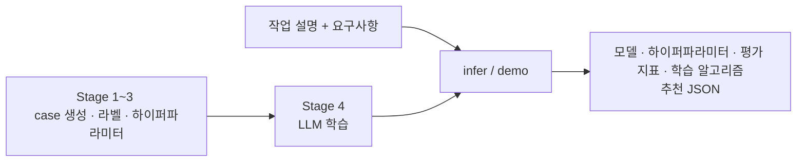
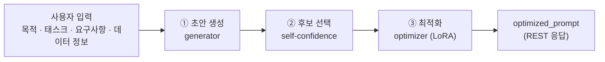
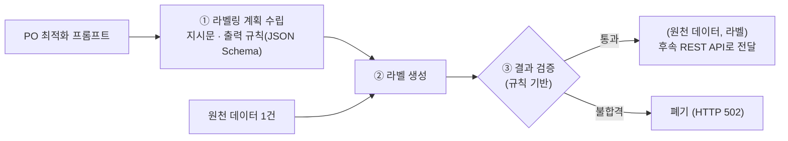

# TANGO2 모듈 README: AR · PO · DA

세 모듈의 README를 한 문서에 요약한 것입니다. 상세 내용은 각 모듈 디렉터리의 README를 참고하세요.

| 모듈 | 디렉터리 | 역할 |
|---|---|---|
| AR (Algorithm Recommend) | [ar-module/](ar-module/README.md) | 작업 설명·요구사항에 맞는 모델 / 학습 알고리즘 / 평가 지표 / 하이퍼파라미터 추천 |
| PO (Prompt Optimization) | [prompt-module/](prompt-module/README.md) | 사용자 입력과 프롬프트 목적으로 프롬프트 초안 생성 → 후보 선택 → 최적화 |
| DA (Data Annotation) | [da-module/](da-module/README.md) | PO 프롬프트로 원천 데이터 1건에 라벨 생성 → 검증 → 후속 API 전달 |

---

## AR 모듈: 알고리즘 추천

사용자가 자연어로 쓴 **작업 설명 + 요구사항**을 읽고 학습할 **모델 / 학습 알고리즘(SFT·LoRA·QLoRA) / 평가 지표 / 하이퍼파라미터 / 학습·동결 모듈 계획**을 JSON(`label_2`)으로 추천합니다.
규칙 기반 파이프라인으로 학습 데이터를 만들고, 그 데이터로 LoRA SFT한 `google/gemma-4-E4B-it` 추천기가 추천 JSON을 생성합니다.



| 단계 | 처리 |
|---|---|
| Stage 1~3  | 후보 목록 무작위 조합 5,000 case → 라벨(model·algorithm·metric) → 하이퍼파라미터·학습/동결 모듈 계획. Stage 2·3을 동시에 통과하도록 case/label 확정 |
| Stage 4 (LLM 학습) | 검수 완료 자연어 요청문(번들 `resources/audited_requests_v4.json`)에 변경 사실(GPU·언어·분량)만 치환해 학습 데이터(`data/`)를 만들고 LLM을 LoRA SFT로 학습 |
| infer / demo | 학습한 LLM이 작업 설명 + 요구사항을 읽어 모델 · 하이퍼파라미터 · 평가 지표 · 학습 알고리즘 추천 JSON을 생성·검증·저장. FastAPI 웹 데모 제공 |

추천기는 final-answer 모드로 동작하며 규칙으로 결과를 대신 만들지 않습니다. `valid`/`errors`는 JSON 구조와 후보 목록 검사 결과일 뿐 학습 성공을 보장하지 않습니다(`empirically_validated`, `ready_to_execute`는 항상 false).

**입력 / 출력**

- 입력: `task_description`(작업 설명), `requirements`(요구사항). 프로그램이 Stage 4 태그(`<USER_TASK_DESCIRPTION>`, `<USER_REQUIREMENTS>`)로 묶어 모델에 전달합니다.
- 출력: `artifacts/inference_results/prediction_*.json`. `label_2.recommendation`에 `model`, `algorithm`, `evaluation_metric`, `hyperparameters`, `training_plan`, `recommendation_reason`이 들어가고 `valid`, `errors`, `raw_output`, `finished`가 함께 저장됩니다.

**실행**

```bash
cd ar-module
pip install -r requirements.txt -r requirements-demo.txt -r requirements-dev.txt   # etri conda 환경에는 설치됨
CUDA_VISIBLE_DEVICES=0 bash scripts/infer.sh "작업 설명" "요구사항"     # 번들 checkpoint로 추천 (약 9GB)
CUDA_VISIBLE_DEVICES=0 bash scripts/demo.sh 8004                      # 웹 데모 http://127.0.0.1:8004
bash scripts/build_dataset.sh                                         # 데이터 재생성 (CPU, 약 2분)
CUDA_VISIBLE_DEVICES=0 bash scripts/train.sh artifacts/outputs/gemma4-lora lora   # 재학습 (약 4.5시간)
bash scripts/test.sh                                                  # 테스트
```

웹 데모 API: `GET /api/status`, `POST /api/recommend` → `{"job_id"}`(202, 동시 1건), `GET /api/jobs/{id}`, `GET /api/jobs/{id}/download`. Docker는 `docker compose --profile gpu up --build`.

| 설정 (`.env`, `AR_*`) | 기본값 / 용도 |
|---|---|
| `AR_CHECKPOINT` | `checkpoints/gemma4-lora-final`. `infer`/`demo`가 쓰는 checkpoint |
| `AR_BASE_MODEL` | `google/gemma-4-E4B-it`. 학습·Stage 4 베이스 모델 (HF 캐시 필요, 오프라인은 `--local-files-only`) |
| `AR_ARTIFACTS_DIR` / `AR_DATA_DIR` / `AR_DATASET_DIR` | `artifacts/` / `data/` / `resources/dataset/` |
| `DEMO_PORT` | `8004` |

---

## PO 모듈: 프롬프트 생성 및 최적화

**사용자 입력(태스크·요구사항·데이터 정보)과 프롬프트 목적**을 받아 후속 모듈(데이터 증강, 학습 등)을 동작시킬 프롬프트를 만듭니다.
pretrained LLM(generator)이 초안 후보를 생성하고, self-confidence로 후보를 고른 뒤, 학습된 optimizer(LoRA)가 최적화해 반환합니다.



| 단계 | 처리 |
|---|---|
| ① 초안 생성 | 입력을 `templates/meta_prompt.j2`에 넣어 generator 호출. `<prompt>...</prompt>` 안쪽만 초안으로 사용 |
| ② 후보 선택 | 켜면 후보 N개를 샘플링해 self-confidence 최고 후보 선택(`logprob` 기본 / `verbalized` / `hybrid`). 끄면 greedy 1개 |
| ③ 최적화 | 선택된 초안을 optimizer에 입력. 빈 결과면 초안을 그대로 반환하고 `warnings`에 기록 |

generator와 optimizer의 베이스 모델이 같으면 가중치를 한 번만 올리고 LoRA on/off로 구분합니다.

**API 입력** `POST /v1/prompts/generate`

| 필드 | 의미 |
|---|---|
| `prompt_objective` | 생성할 프롬프트의 역할 (예: 데이터 증강 프롬프트, 학습 인스트럭션) |
| `task_description` / `requirement` | 태스크 설명 / 요구사항 |
| `data_format` / `data_schema` / `data_label` | 데이터 형식 / 스키마 / 라벨 목록(선택) |
| `options` | 선택. `use_candidate_selection`, `num_candidates`, `confidence_method`, `skip_optimization`, `return_intermediate` |

`POST /v1/prompts/optimize`는 초안을 직접 넣어 ③만 실행합니다.

**API 출력**: `request_id`, `optimized_prompt`, `initial_prompt`, `candidates`(후보별 점수), `warnings`, `timings_ms`, `models`. 후속 모듈은 `optimized_prompt`와 `request_id`만 사용합니다.

| 상황 | 처리 |
|---|---|
| 입력 오류 · generator가 빈 프롬프트 생성 | HTTP 422 |
| 모델 실행 실패 | HTTP 500 |
| optimizer 출력이 비었거나 태그 없음 | HTTP 200, `warnings`에 기록 |

**실행**

```bash
cd prompt-module
test -f .env || cp .env.example .env
docker compose --profile gpu up --build -d          # http://localhost:8000/docs
curl -sS --max-time 600 http://localhost:8000/v1/prompts/generate \
  -H 'Content-Type: application/json' --data-binary @examples/request.json
python3 examples/client.py                          # 예제 클라이언트 (--no-selection, --file ...)
docker compose --profile mock up --build            # GPU 없이 API 흐름 확인
python -m pytest -q                                 # mock 백엔드 테스트
```

| 설정 (`.env`, `PM_*`) | 기본값 / 용도 |
|---|---|
| `PM_GENERATOR_MODEL` / `PM_OPTIMIZER_MODEL` | 예: `google/gemma-4-E4B-it`. 같아야 가중치 공유 |
| `PM_OPTIMIZER_ADAPTER` | optimizer LoRA 경로 (`./adapters` → `/adapters`) |
| `PM_*_BACKEND` | `hf`. OpenAI 호환 서버는 `openai`, 테스트는 `mock` |
| `PM_ENABLE_CANDIDATE_SELECTION` / `PM_NUM_CANDIDATES` / `PM_CONFIDENCE_METHOD` | `true` / `4` / `logprob` |
| `PM_TORCH_DTYPE` / `PM_LOAD_IN_4BIT` | `bfloat16` / `false` |

모델 캐시는 `./models`(컨테이너 `/models`), gated 모델은 `HF_TOKEN` 필요. GPU 서버는 Uvicorn worker 한 개를 사용합니다.

---

## DA 모듈: 데이터 증강 (원천 데이터 한 건 라벨링)

**PO 모듈이 최적화한 데이터 증강 프롬프트**를 입력으로 받아 원천 데이터에 라벨을 생성합니다.
하나의 LLM을 두 번 호출해 ① 라벨링 계획을 수립하고 ② 라벨을 생성하며, ③ 규칙 검증을 통과한 (원천 데이터, 라벨)만 후속 REST API로 전달합니다.



| 단계 | 처리 |
|---|---|
| ① 라벨링 계획 수립 | 프롬프트에서 지시문 · 출력 형식 · 출력 규칙(JSON Schema) 생성. 라벨 후보는 `enum`, 요구 항목은 `required`로 고정하고 사용 전 검사 |
| ② 라벨 생성 | 계획 · 작업 맥락 · 원천 데이터 1건을 조립해 같은 모델 재호출. 원천 데이터는 데이터로만 취급(프롬프트 주입 방지), 샘플링 없이 생성 |
| ③ 결과 검증 | 모델 호출 없이 JSON 해석 · 필수 항목 · `enum` · 타입 검사. 불합격이면 폐기하고 전달 중단 |

Few-shot, 품질 필터링, 배치, 작업 큐, 재시도, 결과 저장은 포함하지 않습니다.

**API 입력** `POST /v1/labels/generate`

| 필드 | 의미 |
|---|---|
| `optimized_prompt` | PO가 만든 최적화 프롬프트. 자리표시자 불필요 |
| `raw_data` | 원천 데이터 1건. JSON 객체 또는 CSV/JSON/text 문자열 |
| `po_request_id` | 선택. PO 응답의 `request_id` |
| `output_format` / `output_schema` | 선택. 결과 양식의 명시적 재정의(호환용). `output_schema`를 주면 계획 생성 호출 생략 |

**API 출력**: `labeling_plan`(지시문 · 출력 형식 · 스키마), `result`(`request_id`, `po_request_id`, `raw_data`, `annotation`, `model`), `delivery`(전달 상태). 후속 모듈에는 **`result`만 POST**합니다.

| 상황 | 처리 |
|---|---|
| 입력 · 명시적 스키마 오류 | HTTP 422 |
| 모델 실행 실패 | HTTP 500 |
| 잘못된 계획 또는 결과 형식 위반 | HTTP 502, 전달 중단 |
| 후속 호출 실패 | HTTP 502, `delivery.status=failed` |

**실행**

```bash
cd da-module
test -f .env || cp .env.example .env
docker compose --profile gpu up --build --force-recreate -d   # DA :8002/docs, 데모 수신기 :8003/docs
curl -sS --max-time 600 http://localhost:8002/v1/labels/generate \
  -H 'Content-Type: application/json' --data-binary @examples/request.json
curl -sS http://localhost:8003/last                           # 수신기가 받은 마지막 결과
docker compose --profile mock up --build                      # GPU 없이 확인 (examples/request_mock.json)
```

`examples/request_*.json`은 감성(positive/negative/neutral), 스팸, 개체명 등 작업별 예제이며 README에 기대 결과가 있습니다.

| 설정 (`.env`, `DA_*`) | 기본값 / 용도 |
|---|---|
| `DA_MODEL` | `google/gemma-4-E4B-it`. 계획과 라벨 생성에 같은 모델 |
| `DA_BACKEND` | `hf`. mock 프로필은 `mock` |
| `DA_MODELS_DIR` | `../prompt-module/models`. 실제 캐시 경로로 변경 |
| `DA_PORT` / `DA_RECEIVER_PORT` | `8002` / `8003` |
| `DA_DOWNSTREAM_URL` | `http://demo-receiver:8000/v1/labels`. 실제 후속 API 주소로 변경 |
| `DA_MAX_NEW_TOKENS` / `DA_TORCH_DTYPE` | `512` / `bfloat16` |

GPU와 mock 프로필은 한 번에 하나만 사용하고, GPU 서버는 Uvicorn worker 한 개를 사용합니다.
