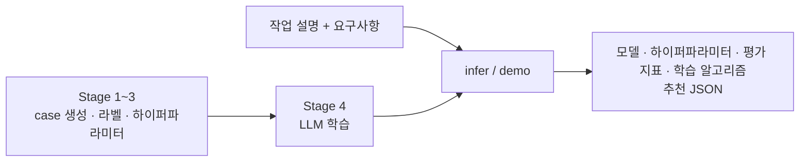

# AR 모듈: 알고리즘 추천 (TANGO2 요구사항 기반 모델·학습 알고리즘 추천)

사용자가 자연어로 쓴 **작업 설명 + 요구사항**을 읽고 학습할 **모델 / 학습 알고리즘(SFT·LoRA·QLoRA) / 평가 지표 / 하이퍼파라미터 / 학습·동결 모듈 계획**을 JSON(`label_2`)으로 추천합니다.
규칙 기반 파이프라인으로 학습 데이터를 만들고, 그 데이터로 LoRA SFT한 `google/gemma-4-E4B-it` 추천기가 추천 JSON을 생성합니다.



| 단계 | 처리 |
|---|---|
| Stage 1~3 | 후보 목록 무작위 조합 5,000 case → 라벨(model·algorithm·metric) → 하이퍼파라미터·학습/동결 모듈 계획. Stage 2·3을 동시에 통과하도록 case/label 확정 |
| Stage 4 (LLM 학습) | 검수 완료 자연어 요청문에 변경 사실(GPU·언어·분량)만 치환해 학습 데이터(`data/`)를 만들고 LLM을 LoRA SFT로 학습 (요청문 자료는 이 저장소에 미포함) |
| infer / demo | 학습한 LLM이 작업 설명 + 요구사항을 읽어 모델 · 하이퍼파라미터 · 평가 지표 · 학습 알고리즘 추천 JSON을 생성·검증·저장. FastAPI 웹 데모 제공 |

이 저장소는 **추론 · 웹 데모 실행용**입니다. 학습 데이터 생성 파이프라인(Stage 1~4)의 입력 자료(`resources/`)는 포함하지 않으며, 그 과정은 위 표의 요약으로 갈음합니다. 학습 완료 checkpoint는 Hugging Face에서 내려받습니다.

추천기는 final-answer 모드로 동작하며 규칙으로 결과를 대신 만들지 않습니다. `valid`/`errors`는 JSON 구조와 후보 목록 검사 결과일 뿐 학습 성공을 보장하지 않습니다(`empirically_validated`, `ready_to_execute`는 항상 false).

## Docker 실행

GPU 서버에서 Docker로 웹 데모(REST API 포함)를 띄우는 것이 기본 실행 방법입니다. 이 디렉터리에서 실행합니다.

**사전 준비 (처음 한 번)**

- NVIDIA 드라이버 570 이상(RTX 50 시리즈), Docker Engine + Compose v2, NVIDIA Container Toolkit.
- Docker 소켓 권한: 실행 계정을 `docker` 그룹에 넣거나(`sudo usermod -aG docker <user>` 후 재로그인) 모든 Docker 명령 앞에 `sudo`를 붙입니다.
- 베이스 모델 `google/gemma-4-E4B-it`가 호스트의 Hugging Face 캐시에 있어야 합니다. 컨테이너는 오프라인(`--local-files-only`)으로 동작하므로 내려받지 않습니다. gated 모델이라 라이선스에 동의한 계정 토큰이 필요합니다.

- 학습 완료 LoRA checkpoint는 Hugging Face [koreamin/TANGO2_Algorithm_Recommend](https://huggingface.co/koreamin/TANGO2_Algorithm_Recommend)에 있습니다(저장소 안 경로 `checkpoints/gemma4-lora-final/`). 이 디렉터리에서 아래 명령으로 받으면 같은 경로에 풀립니다. 컨테이너는 이 폴더를 볼륨으로 마운트해 사용하므로 `docker compose up` 전에 받아 두세요(이미지에는 포함되지 않음).

```bash
pip install -U huggingface_hub
huggingface-cli login
huggingface-cli download google/gemma-4-E4B-it      # 베이스 모델 → ~/.cache/huggingface/hub
huggingface-cli download koreamin/TANGO2_Algorithm_Recommend --include "checkpoints/gemma4-lora-final/*" --local-dir .   # LoRA checkpoint
ls checkpoints/gemma4-lora-final                    # adapter_config.json, adapter_model.safetensors, run_config.json, catalog.json, tokenizer* 확인
```

**설정 (`.env`)**

```bash
test -f .env || cp .env.example .env
```

| 설정 | 기본값 / 용도 |
|---|---|
| `HF_CACHE` | 컨테이너에 마운트할 호스트 캐시 경로. **절대경로로 지정**하세요. 비우면 `~/.cache/huggingface/hub`인데, `sudo docker compose`로 실행하면 `~`가 `/root`로 풀려 모델을 찾지 못합니다 |
| `AR_GPU_ID` | `0`. 컨테이너에 넘길 호스트 GPU 번호. 컨테이너 안에서는 항상 `cuda:0`으로 보입니다 |
| `DEMO_PORT` | `8004`. 호스트에 공개할 포트. 컨테이너 안 포트는 8004 고정 |
| `AR_CHECKPOINT` | `checkpoints/gemma4-lora-final`. [Hugging Face](https://huggingface.co/koreamin/TANGO2_Algorithm_Recommend)에서 내려받은 LoRA checkpoint (볼륨으로 마운트) |

`.env`의 `HF_HOME` 주석은 풀지 마세요. 컨테이너 안 캐시 경로(`/models/hf`)를 덮어씁니다.

**빌드와 실행**

```bash
docker compose --profile gpu up --build -d       # 이미지 빌드 + 백그라운드 실행 (처음 또는 코드 변경 후)
docker compose --profile gpu logs -f             # "Uvicorn running on http://0.0.0.0:8004" 확인 후 Ctrl+C
curl -sS http://localhost:8004/api/status | python3 -m json.tool --no-ensure-ascii
```

`checkpoint_ready: true`가 나오면 준비된 것입니다. 모델은 **첫 추천 요청 때** 별도 worker 프로세스에 로딩되며(약 9GB, 1~3분) 이후 재사용됩니다.

- 웹 데모: http://localhost:8004 (다른 PC에서는 `ssh -L 8004:127.0.0.1:8004 user@server`)
- 결과 JSON: `artifacts/inference_results/`, worker 로그: `artifacts/demo_logs/` (둘 다 호스트에 볼륨으로 남음).

```bash
docker compose --profile gpu down                # 중지
docker compose --profile gpu up -d               # .env 변경 후 재생성 (재빌드 불필요)
docker compose --profile gpu up --build -d       # 코드 · Dockerfile 변경 후 재빌드
docker compose --profile gpu build --no-cache    # 캐시 없이 처음부터 빌드
```

**문제 해결**

| 증상 | 원인 / 조치 |
|---|---|
| `permission denied ... docker.sock` | 계정이 `docker` 그룹에 없음. 그룹 추가 후 재로그인하거나 `sudo` 사용 |
| `port is already allocated` 또는 상태 API 무응답 | 호스트 8004를 다른 프로세스가 사용 중. `ss -ltnp` 출력에서 8004를 쓰는 프로세스를 찾아 종료하거나 `.env`의 `DEMO_PORT` 변경 |
| `Could not import module 'Gemma4ForCausalLM'` + `operator torchvision::nms does not exist` | 베이스 이미지의 torchvision이 torch와 불일치. 현재 Dockerfile은 torch · torchvision을 함께 설치하므로 `--build`로 재빌드 |
| `We couldn't connect to 'https://huggingface.co' ... couldn't find them in the cached files` | 마운트된 캐시에 모델이 없음. `.env`의 `HF_CACHE`를 `models--google--gemma-4-E4B-it`가 있는 절대경로로 지정 후 `up -d` |
| 추천 중 `CUDA out of memory` | 지정 GPU의 여유 메모리 부족(약 9GB 필요). `nvidia-smi` 확인 후 `AR_GPU_ID` 변경 |

## API 입력

웹 데모 서버는 FastAPI이며 입력 화면(`/`)과 아래 REST API를 제공합니다. 추천 생성은 **비동기 작업**으로 처리됩니다. 요청을 보내면 `job_id`를 받고, 상태를 조회하다가 완료되면 결과를 내려받습니다.

| Method | Path | 설명 |
|---|---|---|
| GET | `/api/status` | 서버 · checkpoint 준비 상태 |
| POST | `/api/recommend` | 추천 작업 등록 → `job_id` (HTTP 202) |
| GET | `/api/jobs/{job_id}` | 작업 상태와 결과 조회 |
| GET | `/api/jobs/{job_id}/download` | 결과 JSON 파일 다운로드 |

**`POST /api/recommend`**, `Content-Type: application/json`

| 필드 | 타입 | 의미 |
|---|---|---|
| `task_description` | string | 작업 설명. 학습하려는 모델이 할 일을 자연어로 서술 |
| `requirements` | string | 요구사항. 보유 GPU, 언어, 입력 분량 등 환경 · 제약 조건 |

```json
{
  "task_description": "한국어 보고서의 핵심 내용을 요약하는 모델을 학습하고 싶어요. 적합한 모델과 학습 방법을 추천해 주세요.",
  "requirements": "5090 그래픽 카드 환경이고 보고서는 5페이지 정도입니다."
}
```

입력 규칙:

- 두 필드 모두 필수이며, 앞뒤 공백을 제거한 뒤 1자 이상 20,000자 이하여야 합니다.
- 두 필드는 PO 모듈과 공유하는 **공통 사용자 입력**의 일부입니다(필드명 · 검증 규칙 동일). 공통 입력의 나머지 필드(`data_format`, `data_schema`, `data_label`)나 다른 모듈용 필드가 함께 와도 무시하며, 모델에는 두 필드만 전달합니다. 따라서 같은 사용자 입력 본문을 PO와 AR에 그대로 보낼 수 있습니다.
- 본문에 `<USER_...>` 형태의 태그를 넣으면 거부됩니다(HTTP 422). 태그는 서버가 붙입니다.
- 라벨, 하이퍼파라미터, GPU 메모리 용량 같은 정답 정보는 요청문에 쓰지 않습니다. 추천기가 요구사항에서 환경을 읽어 판단합니다.
- 동시에 1건만 처리합니다. 다른 작업이 진행 중이면 HTTP 409가 반환되므로 완료 후 다시 요청합니다.

서버는 두 필드를 학습 때와 같은 태그(학습 자료의 철자 `DESCIRPTION` 유지)로 묶어 모델에 전달합니다.

```text
<USER_TASK_DESCIRPTION>
작업 설명
</USER_TASK_DESCIRPTION>
<USER_REQUIREMENTS>
요구사항
</USER_REQUIREMENTS>
```

```bash
# 상태 확인
curl -sS http://localhost:8004/api/status | python3 -m json.tool --no-ensure-ascii
# 추천 요청 → job_id
JOB=$(curl -sS -X POST http://localhost:8004/api/recommend -H 'Content-Type: application/json' \
  --data-binary '{"task_description":"한국어 보고서의 핵심 내용을 요약하는 모델을 학습하고 싶어요.","requirements":"5090 그래픽 카드 환경이고 보고서는 5페이지 정도입니다."}' \
  | python3 -c 'import json,sys; print(json.load(sys.stdin)["job_id"])')
# 상태 조회 (state 가 completed 가 될 때까지 반복)
curl -sS "http://localhost:8004/api/jobs/$JOB" | python3 -m json.tool --no-ensure-ascii
# 결과 다운로드
curl -sS "http://localhost:8004/api/jobs/$JOB/download" -o prediction.json
```

## API 출력

**`GET /api/status`**

```json
{
  "title": "TANGO2 Requirement-Driven LLM 모델 : 알고리즘 추천 모듈",
  "version": "revised-1.0",
  "version_label": "추천기 revised-1.0",
  "checkpoint": "/app/checkpoints/gemma4-lora-final",
  "checkpoint_ready": true,
  "message": null,
  "busy": false,
  "model_loaded": false
}
```

`checkpoint_ready`가 false면 `message`에 원인이 들어갑니다. `busy`는 처리 중인 작업 유무, `model_loaded`는 worker에 모델이 올라와 있는지입니다.

**`POST /api/recommend`** → HTTP 202

```json
{"job_id": "3f9c1b2e4d5a6b7c8d9e0f1a2b3c4d5e"}
```

**`GET /api/jobs/{job_id}`** — `state`는 `queued` → `loading`(모델 로딩, 첫 요청만) → `generating` → `completed` 또는 `failed` 순으로 바뀝니다.

```json
{"id": "3f9c...", "state": "generating", "created_at": "2026-10-29T16:10:21.512345+09:00"}
```

완료되면 `result`와 저장 파일명이 함께 옵니다. 실패하면 `state: "failed"`와 `message`(오류 원인)가 옵니다.

```json
{
  "id": "3f9c...",
  "state": "completed",
  "created_at": "2026-10-29T16:10:21.512345+09:00",
  "saved_filename": "prediction_20261029_161305_8c8465d9.json",
  "result": {
    "valid": true,
    "errors": [],
    "label_2": {
      "status": "conditional_recommendation_draft",
      "recommendation": {
        "model": "Qwen/Qwen3-4B",
        "algorithm": "QLoRA",
        "evaluation_metric": "BERTScore",
        "hyperparameters": {"learning_rate": 0.0001, "num_train_epochs": 3, "lora_r": 8, "bits": 4, "...": "후보 목록 내 값"},
        "training_plan": {"trainable_components": ["LoRA_adapter_weights_inside_declared_scope"], "...": "학습/동결/미사용 모듈, adapter 범위"},
        "backend_requirements": {"max_seq_length": 2048, "effective_batch_size": 16, "...": "실행 시 확인 항목"},
        "recommendation_reason": "...",
        "parameter_rationale": "..."
      },
      "thinking": {"recommended": false, "reason": "..."},
      "recommendation_assumptions": {"gpu_capacity": {"value_gb": 12, "user_requested": false, "...": "시스템 가정"}}
    },
    "input": {"user_task_description": "...", "user_requirements": "..."},
    "input_2": "태그로 묶은 모델 입력 원문",
    "raw_output": "모델 생성 원문",
    "finished": true,
    "input_tokens": 466,
    "generated_tokens": 2546,
    "model_generation_performed": true,
    "checkpoint": "/app/checkpoints/gemma4-lora-final",
    "validation_scope": "JSON structure and saved catalog; not proof of task suitability, memory fit, or training success"
  }
}
```

**`GET /api/jobs/{job_id}/download`** — 위 `result` 객체만 JSON 파일(`tango2_<job_id>.json`)로 내려줍니다. 같은 내용이 서버의 `artifacts/inference_results/prediction_<시각>_<id>.json`에도 저장됩니다.

`result`의 주요 필드:

- `label_2`: 모델이 생성한 추천. `recommendation`에 `model`, `algorithm`, `evaluation_metric`, `hyperparameters`, `training_plan`(학습/동결/미사용 모듈, adapter 범위), `backend_requirements`, `recommendation_reason`, `parameter_rationale`. `thinking.recommended`는 추천 대상 작업에 별도 thinking 모델이 권장되는지이며, `recommendation_assumptions`는 사용자 조건이 아닌 시스템 가정(GPU 용량, offload, 페이지→토큰 환산 등)입니다.
- `valid`, `errors`: JSON 구조와 저장된 후보 목록(catalog) 검사 결과. 실제 학습 가능성이나 추천 정확도를 보장하지 않습니다.
- `raw_output`, `finished`, `input_tokens`, `generated_tokens`: 생성 원문과 종료 상태. `finished`가 false면 출력이 잘린 것이므로 서버의 `--max-new-tokens`(기본 4096)를 늘립니다.

| 상황 | 처리 |
|---|---|
| 필드 누락 · 빈 값 · 20,000자 초과 · `<USER_` 태그 포함 | HTTP 422 |
| checkpoint 미준비 | HTTP 503, 본문에 원인 |
| 다른 추천이 생성 중 | HTTP 409, 완료 후 재요청 |
| 알 수 없는 `job_id` (서버 재시작 또는 50건 초과로 정리됨) | HTTP 404 |
| 완료 전 다운로드 | HTTP 409 |
| 모델 로딩 · 생성 실패, 대기 시간 초과 | `state=failed`와 `message`. worker를 종료하고 다음 요청에서 다시 로딩 |

작업 기록은 메모리에 최근 50건만 보관하며 서버를 재시작하면 사라집니다. 결과 파일은 `artifacts/inference_results/`에 남습니다.

## label_2 스키마

`result.label_2`의 전체 구조입니다. `[...]`와 `{...}`는 생략한 하위 항목입니다.

```json
{
  "status": "conditional_recommendation_draft",
  "recommendation": {
    "model": "Qwen/Qwen3-4B", "algorithm": "LoRA", "evaluation_metric": "BERTScore",
    "hyperparameters": {"learning_rate": 1e-4, "per_device_train_batch_size": 1, "gradient_accumulation_steps": 16, "num_train_epochs": 3,
                        "warmup_ratio": 0.03, "weight_decay": 0.01, "max_grad_norm": 1.0, "lr_scheduler_type": "cosine", "optimizer": "AdamW",
                        "training_dtype": "bfloat16", "lora_r": 16, "lora_alpha": 32, "lora_dropout": 0.05, "target_modules": ["q_proj","k_proj","v_proj","o_proj"]},
    "training_plan": {"input_modalities": ["text"], "active_components": [...], "trainable_components": [...], "frozen_but_used_components": [...],
                      "components_to_not_load_if_present": [...], "adapter_scope_prefixes": ["model.layers"], "component_decisions": [...], "sequence_length": {...}, ...},
    "backend_requirements": {"max_seq_length": 2048, "effective_batch_size": 16, "runtime_checks": [...], ...},
    "recommendation_reason": {"model": "...", "algorithm": "...", "evaluation_metric": "..."},
    "parameter_rationale": {...}
  },
  "thinking": {"recommended": false, "explicitly_requested": false, "reason": "...", "request_evidence": null,
               "model_supports_thinking": true, "activation_configured": false, ...},
  "review_reasons": [],
  "recommendation_assumptions": {"gpu_capacity": {"value_gb": 32, "user_requested": false, ...},
                                 "system_execution_policy": {...}, "context_interpretation": {...}, "selected_model_workload": {...}},
  "reason": "...", "source_stage3_status": "recommended_draft",
  "empirically_validated": false, "ready_to_execute": false
}
```

- `hyperparameters`는 알고리즘에 따라 키가 달라집니다. QLoRA면 `bits`, `quant_type`, `double_quant`, `bnb_4bit_compute_dtype`가 추가되고, full SFT면 LoRA 관련 키가 없습니다.
- `training_plan`은 추천 **대상 모델**의 학습 · 동결 · 미사용 모듈 계획이며, `backend_requirements.runtime_checks`는 실제 학습 전에 확인해야 할 항목입니다.
- `empirically_validated`, `ready_to_execute`는 항상 false입니다. 추천은 규칙과 메모리 추정에 기반한 초안입니다.

## CLI 실행 (Docker 없이)

단건 추론 · 로컬 데모 · (선택) 재학습은 로컬 파이썬 환경에서 실행합니다. 이 디렉터리에서 실행합니다.

```bash
conda create -n etri python=3.12 -y && conda activate etri
pip install --index-url https://download.pytorch.org/whl/cu128 torch==2.11.0 torchvision==0.26.0   # CUDA 12.8 (RTX 50 시리즈)
pip install -r requirements.txt            # transformers 5.16 / peft / accelerate (학습·추론)
pip install -r requirements-demo.txt       # fastapi / uvicorn (데모)
pip install -r requirements-dev.txt        # numpy / httpx (테스트)
cp .env.example .env                       # 필요 시 경로·모델 수정
```

현재 서버의 `etri` conda 환경에는 위 패키지가 모두 설치되어 있습니다. 베이스 모델 `google/gemma-4-E4B-it`는 Hugging Face 캐시에 있어야 하며, 오프라인이면 `--local-files-only`(또는 `LOCAL_FILES_ONLY=1`)를 붙입니다.

```bash
python -m algorithm_recommend --help          # 명령 목록

# 0) checkpoint 내려받기 (처음 한 번)
huggingface-cli download koreamin/TANGO2_Algorithm_Recommend --include "checkpoints/gemma4-lora-final/*" --local-dir .

# 1) 내려받은 checkpoint로 바로 추천 (GPU 1개, 약 9GB)
CUDA_VISIBLE_DEVICES=0 bash scripts/infer.sh \
  "한국어 보고서의 핵심 내용을 요약하는 모델을 학습하고 싶어요. 적합한 모델과 학습 방법을 추천해 주세요." \
  "5090 그래픽 카드 환경이고 보고서는 5페이지 정도입니다."
python -m algorithm_recommend infer --interactive              # 빠진 항목을 한 줄씩 질문
python -m algorithm_recommend infer --checkpoint checkpoints/gemma4-lora-final --local-files-only \
  --task-description-file examples/task_description.txt \
  --requirements-file examples/requirements.txt --output my_prediction.json

# 2) 웹 데모 (Docker 없이)  → http://127.0.0.1:8004
CUDA_VISIBLE_DEVICES=0 bash scripts/demo.sh 8004

# 3) (선택) 재학습 (GPU 1개, 32GB 기준 약 4.5시간)
CUDA_VISIBLE_DEVICES=0 bash scripts/train.sh artifacts/outputs/gemma4-lora lora

# 4) 테스트
bash scripts/test.sh
```

CLI 추론 결과는 API의 `result`와 같은 형식으로 `artifacts/inference_results/prediction_<시각>_<id>.json`에 저장됩니다. 로컬 실행에서 GPU는 `CUDA_VISIBLE_DEVICES`로 고릅니다.

경로는 모두 모듈 기준 상대 경로이며 `.env.example`의 `AR_*` 환경변수로 바꿀 수 있습니다.

| 설정 | 기본값 / 용도 |
|---|---|
| `AR_CHECKPOINT` | `checkpoints/gemma4-lora-final`. `infer`/`demo`가 쓰는 학습 완료 checkpoint (`final/` 또는 `checkpoint-N/`) |
| `AR_BASE_MODEL` / `AR_BASE_REVISION` | `google/gemma-4-E4B-it` / `main`. 학습과 Stage 4 요청문 생성의 베이스 모델 |
| `AR_DATA_DIR` | `data/`. 준비된 SFT 데이터 |
| `HF_HOME` / `HF_HUB_OFFLINE` / `HF_TOKEN` | 로컬 실행용 Hugging Face 캐시 위치 / 오프라인 사용 / gated 모델 토큰 |
| `HF_CACHE` / `AR_GPU_ID` / `DEMO_PORT` | Docker 전용. 위 "Docker 실행" 참조 |

## 명령 (`python -m algorithm_recommend <command> --help`)

| 명령 | 역할 | 입력 → 출력 |
|---|---|---|
| `infer` | checkpoint로 추천 JSON 생성·검증·저장 | → artifacts/inference_results/ |
| `demo` | 웹 데모 서버 (FastAPI + 모델 worker) | |
| `verify` | data/·checkpoint 무결성 보고서 | → artifacts/verification_report.json |
| `train` | (선택) LoRA/QLoRA/full SFT, `--dry-run`은 tokenizer 검사만 | data/ → artifacts/outputs/<run>/final |

`stage1`~`stage4*`, `revise*`, `prepare` 등 학습 데이터 생성 명령도 패키지에 남아 있지만, 입력 자료(`resources/`)가 이 저장소에 없어 실행되지 않습니다.

## 재학습 (선택)

```bash
python -m algorithm_recommend train --model gemma --local-files-only --dry-run --output-dir artifacts/reports/tokenization   # tokenizer 검사
CUDA_VISIBLE_DEVICES=0 python -m algorithm_recommend train --model google/gemma-4-E4B-it --finetuning lora --local-files-only \
  --output-dir artifacts/outputs/gemma4-lora
CUDA_VISIBLE_DEVICES=0 python -m algorithm_recommend train ... --resume-from-checkpoint artifacts/outputs/gemma4-lora/checkpoint-100
```

- 기본: LoRA r=16/alpha=32/dropout=0.05(q/k/v/o projection), lr 2e-4, 3 epoch, batch 1, accumulation 8, 길이 4,096(요청+정답 토큰; case 안의 context_length와 무관), bf16, gradient checkpointing, chunked LM-head loss.
- Gemma 4의 텍스트 모델만 로딩합니다(vision/audio tower 미생성). 정답 속 vision/audio 학습 계획은 **추천 대상 모델**의 설정입니다.
- `--finetuning full`(lr 2e-5) / `qlora`도 가능하지만 QLoRA GPU 학습은 검증하지 않았습니다. 한 프로세스·한 GPU만 지원합니다.
- 완료 시 `<output>/final/`에 adapter, tokenizer, chat template, catalog, run_config가 저장되고 `infer`/`demo`의 `--checkpoint`로 지정합니다.
- 공개 checkpoint [koreamin/TANGO2_Algorithm_Recommend](https://huggingface.co/koreamin/TANGO2_Algorithm_Recommend)는 이 데이터(`data/`)로 3 epoch 학습한 결과입니다(train_loss 0.067). `python -m algorithm_recommend verify`가 data 해시와 checkpoint의 일치를 확인합니다. 재학습이 필요 없다면 `data/`(60MB)는 지워도 추론·데모에 영향이 없습니다.

## 데이터

| 파일 | 건수 | 설명 |
|---|---:|---|
| data/train.jsonl | 4,474 | `{case_id, messages:[system, user(input_2), assistant(label_2 JSON)]}` |
| data/validation.jsonl | 254 | 같은 의미 그룹(원본·수정)을 분리하지 않은 검증 |
| data/test.jsonl | 272 | Trainer에 전달하지 않는 보류 집합 |

5,000 case 전부 `recommended_draft`이며 제외는 0건입니다. 환경 조합은 4,798개이고 TTS 202건은 환경을 재사용한 서로 다른 요청문입니다. `thinking.recommended=true` 예시는 0건이므로 thinking 필요/불필요 양쪽을 학습했다고 볼 수 없습니다. 페이지 수의 512토큰 환산은 합성 데이터의 가정입니다.

## 검증 범위와 한계

- `data/`와 checkpoint는 SHA-256으로 서로 대조됩니다(`verify`). 상위 파이프라인 산출물이 없는 이 저장소에서는 `train`과 `verify`가 데이터 해시만 검사합니다.
- 라벨과 하이퍼파라미터는 공개 문서 기반 규칙과 메모리 추정의 초안이며 실제 학습 성공을 실측한 것이 아닙니다. case별 외부 LLM API 호출은 없습니다. 실제 실행 전에는 dtype/attention 지원, `named_modules` 대조, forward/backward 메모리 측정이 필요합니다.
- 학습 데이터의 요청문은 합성 데이터이며 사람이 쓴 글이 아닙니다. thinking=true 예시가 없고, 페이지 수 → 토큰 환산은 가정입니다.
- 추론 결과의 `valid`는 형식 · catalog 검사만을 뜻하며 추천의 의미적 정확성이나 학습 성공을 보장하지 않습니다.

## 테스트

```bash
bash scripts/test.sh            # recommender · 데모 API · Stage 4 검사 · revision 정책 테스트; torch/fastapi 없으면 일부 skip
```

## 예제

`examples/`의 입력 파일은 요약 작업 추천 예시입니다. 모델이 생성하므로 결과는 실행마다 다를 수 있으며, 아래는 공개 checkpoint의 참고 결과입니다.

| 예제 | 내용 | 참고 결과 |
|---|---|---|
| `task_description.txt` | 한국어 보고서 핵심 내용 요약 모델 학습, 모델·학습 방식·하이퍼파라미터·평가 지표 추천 요청 | `model=Qwen/Qwen3-4B`, `algorithm=QLoRA`, `evaluation_metric=BERTScore` |
| `requirements.txt` | 5090 그래픽 카드, 보고서 5페이지 분량 | `max_seq_length=2048`, `thinking.recommended=false` |

```bash
CUDA_VISIBLE_DEVICES=0 python -m algorithm_recommend infer --checkpoint checkpoints/gemma4-lora-final --local-files-only \
  --task-description-file examples/task_description.txt \
  --requirements-file examples/requirements.txt --output /tmp/ar-example.json && \
  python3 -m json.tool --no-ensure-ascii /tmp/ar-example.json
```

응답의 `valid=true`, `errors=[]`, `finished=true`와 `label_2.recommendation`을 확인하세요.

## 디렉터리 구조

```
algorithm_recommend/              파이썬 패키지 (python -m algorithm_recommend <command>)
  paths.py                        모듈 상대 경로·환경변수(AR_*) 레이아웃
  io_utils.py                     JSON/해시/백업 공통 유틸
  recommender/                    common.py(label_2 계약·system prompt), modeling.py(텍스트 전용 Gemma 4 로딩),
                                  inference.py, inference_output.py, verify.py, train.py, sft_loss.py, prepare_data.py
    demo/                         app.py(FastAPI), worker.py(모델 프로세스), static/(HTML·CSS·JS·나눔스퀘어 폰트)
  stage1_environments/ · stage2_labels/ · stage3_hyperparameters/ · stage4_requests/ · revision/
                                  학습 데이터 생성 파이프라인 코드 (입력 자료 미포함, 참고용)
data/                             checkpoint 학습에 쓴 SFT 데이터 (train/validation/test.jsonl, catalog.json, preparation_report.json) — 재학습·verify용
checkpoints/gemma4-lora-final/    학습 완료 LoRA adapter + tokenizer + catalog + run_config (저장소 미포함, Hugging Face koreamin/TANGO2_Algorithm_Recommend 에서 내려받음)
scripts/                          infer.sh, demo.sh, train.sh, test.sh
tests/                            unittest (torch/fastapi 없으면 해당 테스트 skip)
examples/                         추론 입력 예시 파일
```

