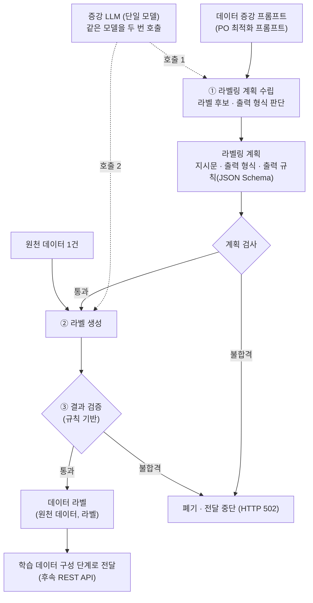

# DA 모듈: 데이터 증강 (원천 데이터 한 건 라벨링)

데이터 증강(DA) 모듈은 **PO 모듈이 최적화한 데이터 증강 프롬프트**를 입력으로 받아 원천 데이터에 라벨을 생성합니다.
하나의 증강 LLM을 두 번 호출해 ① 라벨링 계획을 수립하고 ② 라벨을 생성하며, ③ 규칙 기반 결과 검증을 통과한 (원천 데이터, 라벨)만 학습 데이터 구성 단계로 전달합니다.



| 단계 | 처리 |
|---|---|
| ① 라벨링 계획 수립 | 증강 LLM이 프롬프트를 해석해 라벨링 지시문 · 출력 형식 · 출력 규칙(JSON Schema)을 만듭니다. 프롬프트 속 라벨 후보는 `enum`, 요구된 항목은 `required`로 고정합니다. 계획은 사용 전에 스키마 문법, `required` ⊆ `properties`, `enum` 후보가 프롬프트에 그대로 있는지, text 형식이면 `string`인지 검사합니다. |
| ② 라벨 생성 | 역할 지시 · 라벨링 계획 · 작업 맥락(데이터 증강 프롬프트) · 원천 데이터 1건을 하나의 입력으로 조립해 같은 증강 LLM을 다시 호출합니다. 원천 데이터는 지시가 아닌 데이터로만 취급하고(프롬프트 주입 방지), 샘플링 없이 생성해 같은 입력에는 같은 라벨을 출력합니다. |
| ③ 결과 검증 | 모델 호출 없이 생성된 라벨이 출력 규칙을 지키는지(JSON 해석, 필수 항목, `enum`, 타입) 검사합니다. 통과하면 (원천 데이터, 라벨)을 전달하고, 불합격하면 폐기하고 전달을 중단합니다. |

Few-shot, 데이터 품질 필터링, 배치, 작업 큐는 포함하지 않습니다.
PO 응답의 `optimized_prompt`와 `request_id`를 아래 API 입력의 `optimized_prompt`, `po_request_id`에 넣어 DA를 호출합니다.

## API 입력

`POST /v1/labels/generate`, `Content-Type: application/json`

상태 확인은 `GET /health`이며 `{"status": "ok", "model": "hf:<모델 ID>"}`를 반환합니다. 모델 로딩이 끝난 뒤에만 응답합니다.

| 필드 | 의미 |
|---|---|
| `optimized_prompt` | PO 모듈에게 받은 최적화된 데이터 증강 프롬프트 |
| `raw_data` | 원천 데이터 한 건. JSON 객체는 JSON으로, 문자열은 그대로 모델에 전달합니다. 배열(여러 건)은 받지 않습니다. |
| `po_request_id` | 선택. PO 응답의 `request_id`를 연결하는 ID |

```json
{
  "po_request_id": "po-demo-1",
  "optimized_prompt": "충돌 위험을 있음 / 없음 중 하나로 표시하고, 자선 상황을 한국어 3~5문장으로 서술하세요.",
  "raw_data": {
    "ship_id": "S01", "my_ship": 1, "latitude": 35.05, "longitude": 129.07, "knot": 12.0, "heading": 45,
    "nearby_ships": [{"ship_id": "S02", "relative_bearing": "우현", "distance_nm": 0.8, "knot": 9.5, "heading": 315}]
  }
}
```

- DA는 `optimized_prompt`에서 라벨 후보와 출력 형식을 판단해 라벨링 계획을 수립합니다. 프롬프트 속 라벨 후보(예: 있음/없음)는 출력 규칙의 `enum`으로, 요구된 항목은 `required`로 고정합니다.
- `optimized_prompt`는 비어 있지 않은 문자열이면 됩니다. `{{input_data}}`를 요구하지 않으며, 기존 자리표시자가 있어도 프롬프트 내용 그대로 보존합니다.
- DA가 원천 데이터를 별도 영역에 넣으므로 프롬프트에 데이터 삽입 위치를 정할 필요가 없습니다.
- 원천 데이터 형식과 라벨 결과 형식은 별개입니다. 결과 형식·필수 필드·단일/복수 라벨은 프롬프트에 맞춰 DA가 구성합니다.
- 위 표에 없는 필드(이전 버전의 `user_input` 등)를 보내면 HTTP 422로 거절합니다.

기존 호출자와의 호환을 위해 `output_format`(`json`/`text`), `output_schema`(JSON Schema draft 2020-12)를 선택적으로 직접 지정할 수도 있습니다.
이는 **DA 결과 양식의 명시적 재정의**이며 PO의 필수 출력이 아닙니다.
`output_schema`를 지정하면 DA가 프롬프트로 지시문을 구성하고 지정된 규칙을 사용하므로 계획 생성용 모델 호출은 생략합니다.
`output_format`만 지정하면 DA가 해당 형식을 지켜 계획을 생성합니다. 둘 다 생략하는 것이 기본 사용법입니다.

## API 출력과 후속 전달

응답에 `labeling_plan`(DA가 구성한 지시문·출력 형식·검증 스키마), `result`(생성 결과), `delivery`(전달 상태)가 들어갑니다.

```json
{
  "labeling_plan": {
    "instruction": "자선 상황 서술과 충돌 위험 출력",
    "output_format": "json",
    "output_schema": {
      "type": "object",
      "properties": {
        "risk": {"enum": ["있음", "없음"]},
        "description": {"type": "string"}
      },
      "required": ["risk", "description"]
    }
  },
  "result": {
    "request_id": "DA가 만든 ID",
    "po_request_id": "po-demo-1",
    "raw_data": {"ship_id": "S01", "my_ship": 1, "...": "요청의 raw_data 그대로"},
    "annotation": {
      "risk": "있음",
      "description": "자선은 12노트로 북동진(045도) 중이다. 우현 약 0.8해리에 있는 S02가 9.5노트로 북서진(315도)하고 있다. 두 선박의 진로가 교차하고 있어 충돌 위험이 있다."
    },
    "model": "hf:google/gemma-4-E4B-it"
  },
  "delivery": {"status": "delivered", "status_code": 200, "error": null}
}
```

`annotation`은 작업에 따라 객체·배열·문자열 등이 됩니다. 텍스트 결과도 REST 응답의 JSON 안에서는 문자열로 표현합니다.
후속 모듈에는 **`result`만 JSON 본문으로 POST**하며 HTTP 2xx를 전달 성공으로 처리합니다.
`labeling_plan`은 호출자가 구성 내용을 확인하도록 반환합니다.

| 상황 | 처리 |
|---|---|
| 입력·명시적 스키마 오류 | HTTP 422 |
| 모델 실행 실패 | HTTP 500 |
| 잘못된 DA 계획 또는 결과 형식 위반 | HTTP 502, 후속 전달 중단 |
| 후속 호출 실패 | HTTP 502와 생성 결과·계획·`delivery.status=failed` 반환 |

자동 재시도나 결과 영구 저장은 없습니다. 재호출하면 계획·라벨을 다시 생성하고 다시 전달합니다.
계획은 LLM이 생성하고 프로그램이 필수 항목, 스키마 문법, 객체 필수 필드, 배열 항목 정의를 확인합니다. `enum`의 문자열 후보는 모두 `optimized_prompt`에 그대로 들어 있어야 하며, 프롬프트에 없는 후보가 있으면 502로 중단합니다.
스키마 검증은 외부 참조를 다운로드하지 않습니다. 형식 검증이 의미적 정답이나 품질 점수를 보장하지는 않습니다.

## Docker 실행과 모델 설정

이 디렉터리에서 실행합니다. `.env`가 없을 때만 복사하고 `DA_MODELS_DIR`이 실제 캐시를 가리키는지 확인하세요.

```bash
test -f .env || cp .env.example .env
docker compose --profile gpu up --build --force-recreate -d
docker compose --profile gpu logs -f da-module
```

Docker 소켓 권한이 없다면 Docker 명령 앞에 `sudo`를 붙입니다.
`Ready. model=hf:...` 로그 확인 후 Ctrl+C로 로그 조회를 종료해도 서버는 계속 실행됩니다. 코드 변경 후에는 이미지를 다시 빌드해야 합니다.

- DA 문서: http://localhost:8002/docs
- 데모 수신기: http://localhost:8003/docs
- 수신기가 받은 마지막 결과: http://localhost:8003/last

```bash
curl -sS http://localhost:8002/health | python3 -m json.tool
curl -sS --max-time 600 http://localhost:8002/v1/labels/generate \
  -H 'Content-Type: application/json' \
  --data-binary @examples/request.json \
  | python3 -m json.tool --no-ensure-ascii
curl -sS http://localhost:8003/last | python3 -m json.tool --no-ensure-ascii
```

mock 연결 확인에는 `examples/request_mock.json`을 사용합니다. mock은 고정 계획과 `mock_label`을 반환하며 실제 작업 추론을 하지 않습니다.

```bash
docker compose --profile gpu down
docker compose --profile mock up --build
```

GPU와 mock 프로필은 한 번에 하나만 사용하세요.
실제 후속 API를 연결한 뒤에는 `docker compose --profile gpu up --build --no-deps da-module`로 데모 수신기 없이 실행할 수 있습니다.

기본 Docker 베이스는 `pytorch/pytorch:2.7.1-cuda12.8-cudnn9-runtime`이고, Gemma 4를 읽기 위해 `transformers>=5.5`를 설치합니다.
모델 변경은 `.env`의 `DA_MODEL`을 수정하고 컨테이너를 재생성합니다. 모델 ID 변경만으로 재빌드는 필요하지 않습니다.

| 설정 | 기본값 / 용도 |
|---|---|
| `DA_MODEL` | `google/gemma-4-E4B-it`. 계획 구성과 라벨 생성에 같은 모델 사용 |
| `DA_BACKEND` | `hf`. mock 프로필은 `mock` |
| `DA_GPU_ID` | GPU `0` |
| `DA_MODELS_DIR` | `../prompt-module/models`. 위치 변경 시 실제 캐시의 절대경로 또는 `./models` |
| `DA_TORCH_DTYPE` | `bfloat16` (`float16`, `float32` 가능) |
| `DA_DEVICE_MAP` | `auto`. Transformers `device_map`으로 그대로 전달 |
| `DA_TRUST_REMOTE_CODE` | `false`. 모델 저장소의 사용자 정의 코드 실행 허용 여부 |
| `DA_MAX_NEW_TOKENS` | `512`. 각 모델 호출의 최대 생성 길이 |
| `DA_PORT` / `DA_RECEIVER_PORT` | `8002` / `8003` |
| `DA_DOWNSTREAM_URL` | `http://demo-receiver:8000/v1/labels`. 실제 후속 API 주소로 변경 |
| `DA_DOWNSTREAM_TIMEOUT` | `30`초 |

모델은 Transformers의 `AutoModelForCausalLM`과 chat template을 지원해야 합니다.
GPU 서버는 Uvicorn worker 한 개를 사용합니다.
컨테이너에서 호스트의 후속 API를 호출할 때는 `http://host.docker.internal:포트/경로`를 사용합니다.

## 작업별 예제

모든 예제는 최적화된 프롬프트와 원천 데이터 한 건만 보내며, 출력 스키마를 보내지 않습니다. 라벨 후보와 출력 형식은 프롬프트에 적혀 있습니다.

| 예제 | 기대 결과 |
|---|---|
| `request.json` | `risk=있음`, `description`에 자선 상황 서술 |
| `request_positive.json` | `positive` |
| `request_negative.json` | `negative` |
| `request_neutral.json` | `neutral` |
| `request_positive_low_rating.json` | 본문 우선, `positive` |
| `request_negative_high_rating.json` | 본문 우선, `negative` |
| `request_spam.json` | `category=spam`, `explanation` 필수 |
| `request_spam_text.json` | `spam` 텍스트 |
| `request_entities.json` | 김민수/PERSON, 서울/LOCATION, 삼성전자/ORGANIZATION |

```bash
for case in positive negative neutral positive_low_rating negative_high_rating spam spam_text entities; do
  curl -sS --max-time 600 http://localhost:8002/v1/labels/generate \
    -H 'Content-Type: application/json' \
    --data-binary "@examples/request_$case.json" \
    -o "/tmp/da-$case.json" && \
    python3 -m json.tool --no-ensure-ascii "/tmp/da-$case.json"
done
```

각 응답의 `labeling_plan`, `result.annotation`, `delivery.status=delivered`를 확인하세요.
수신기는 마지막 결과만 보관하므로 `/last`의 `request_id`를 마지막 응답과 비교합니다.

## 개발

### 코드 구조

| 파일 | 역할 |
|---|---|
| `app/main.py` | FastAPI 앱(`GET /health`, `POST /v1/labels/generate`). 계획 수립 → 라벨 생성 → 결과 검증 → 후속 전달 순서와 상태 코드(500/502)를 처리합니다. |
| `app/schemas.py` | 요청·응답 모델(`LabelRequest`, `LabelingPlan`, `LabelResult`, `Delivery`, `LabelResponse`). 입력 검증과 명시적 `output_schema` 검사(422)를 담당합니다. |
| `app/labeling.py` | 두 번의 모델 호출에 넣을 메시지 조립(`build_plan_messages`, `build_messages`), 계획 검사(`parse_plan`), 결과 검증(`parse_annotation`). |
| `app/llm.py` | 모델 백엔드(`HFBackend`, `MockBackend`)와 선택 함수 `build_backend`. |
| `app/config.py` | `DA_` 접두사 환경 변수와 실행 위치의 `.env`를 읽는 설정(`Settings`). 환경 변수가 `.env`보다 우선합니다. |
| `examples/receiver.py` | 후속 API 대역. `POST /v1/labels`로 받은 결과 중 마지막 한 건을 `GET /last`로 보여 줍니다. |

### 로컬 실행 (Docker 없이)

`requirements.txt`에는 PyTorch가 없습니다(Docker 이미지는 PyTorch 베이스 이미지를 사용). hf 백엔드로 실행하려면 CUDA 환경에 맞는 PyTorch를 먼저 설치합니다.

```bash
python3 -m venv .venv && source .venv/bin/activate
pip install torch  # CUDA 버전에 맞는 빌드 선택
pip install -r requirements.txt
```

`.env.example`의 `DA_DOWNSTREAM_URL`은 컨테이너 주소(`demo-receiver`)이므로 로컬에서는 환경 변수로 바꿔 실행합니다. `.env`가 없으면 기본값은 `http://127.0.0.1:8003/v1/labels`입니다.

```bash
uvicorn examples.receiver:app --port 8003 &
DA_DOWNSTREAM_URL=http://127.0.0.1:8003/v1/labels uvicorn app.main:app --port 8002 --workers 1
```

`DA_GPU_ID`와 `DA_MODELS_DIR`은 Docker에서만 쓰입니다. 로컬에서는 GPU를 `CUDA_VISIBLE_DEVICES`로 고르고, 모델은 Hugging Face 기본 캐시(`~/.cache/huggingface/hub`)에서 읽거나 내려받습니다. 이미 받아 둔 캐시가 다른 곳에 있으면 `HF_HUB_CACHE`로 지정합니다.

```bash
CUDA_VISIBLE_DEVICES=3 HF_HUB_CACHE=/path/to/huggingface/hub \
  DA_DOWNSTREAM_URL=http://127.0.0.1:8003/v1/labels uvicorn app.main:app --port 8002 --workers 1
```

모델 없이 연결만 확인할 때는 DA 실행 명령 앞에 `DA_BACKEND=mock`을 붙입니다. mock 실행에는 PyTorch와 Transformers가 필요 없으며 `fastapi uvicorn pydantic-settings httpx jsonschema`만 설치하면 됩니다.

### 모델 백엔드

`DA_BACKEND`로 선택합니다.

- `hf`: Transformers `AutoModelForCausalLM`과 chat template을 사용하고 샘플링 없이 생성합니다. 생성은 lock으로 한 번에 하나씩 처리하므로 Uvicorn worker는 1개로 실행합니다. chat template이 system 역할을 지원하지 않으면 system과 user 메시지를 하나의 user 메시지로 합칩니다. `torch`, `transformers`는 이 백엔드를 만들 때만 import합니다.
- `mock`: 모델 없이 고정 계획과 `{"label": "mock_label", ...}`을 반환합니다. 첫 메시지(system)가 `"You prepare a labeling plan"`으로 시작하면 계획 호출로 판단하므로, `app/labeling.py`의 `build_plan_messages` system 문구 앞부분을 바꾸면 `MockBackend`도 함께 고쳐야 합니다.

다른 백엔드를 추가하려면 `name` 속성과 `generate(messages) -> str` 메서드를 가진 클래스를 `app/llm.py`에 만들고, `build_backend`와 `app/config.py`의 `backend` 선택지에 등록합니다.