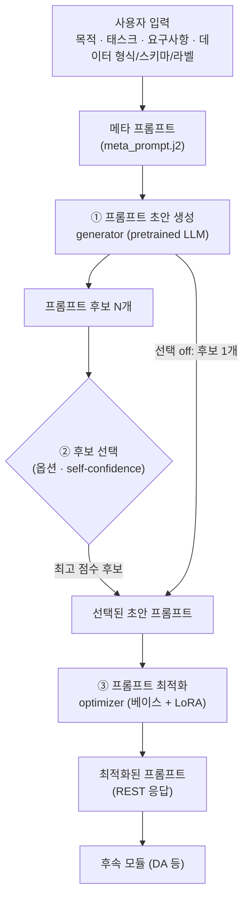

# PO 모듈: 프롬프트 생성 및 최적화

프롬프트 최적화(PO) 모듈은 **사용자 입력(태스크·요구사항·데이터 정보)과 프롬프트 목적**을 받아, 후속 모듈(데이터 증강, 학습 등)을 동작시킬 프롬프트를 만듭니다.
pretrained LLM(generator)이 ① 메타 프롬프트로 프롬프트 초안 후보를 생성하고, ② 선택적으로 self-confidence가 가장 높은 후보를 고른 뒤, ③ 학습된 optimizer가 초안을 최적화해 REST API로 반환합니다.



| 단계 | 처리 |
|---|---|
| ① 초안 생성 | 사용자 입력을 `templates/meta_prompt.j2`에 넣어 메타 프롬프트를 만들고 generator를 호출합니다. 모델 출력에서 `<prompt>...</prompt>` 안쪽만 초안으로 사용합니다. |
| ② 후보 선택 | 켜면 후보 N개를 샘플링하고 self-confidence 점수가 가장 높은 후보를 고릅니다. 끄면 후보 1개를 greedy로 생성해 같은 입력에 같은 초안이 나옵니다. |
| ③ 최적화 | 선택된 초안을 optimizer에 입력해 최적화된 프롬프트를 출력합니다. optimizer가 빈 결과를 내면 초안을 그대로 반환하고 `warnings`에 기록합니다. |

generator와 optimizer의 베이스 모델이 같으면 가중치를 한 번만 GPU에 올립니다. generator는 LoRA를 끈 상태로, optimizer는 LoRA를 켠 상태로 같은 모델을 사용합니다.

### Self-confidence 방식

| 방식 | 점수 | 추가 모델 호출 |
|---|---|---|
| `logprob` (기본) | 후보 생성 토큰 확률의 기하평균 `exp(평균 log-prob)` | 없음 |
| `verbalized` | generator에게 후보별 0~100점을 질의(`confidence_prompt.j2`)해 /100 | 후보 수만큼 |
| `hybrid` | `PM_HYBRID_WEIGHT × logprob + (1 − w) × verbalized` | 후보 수만큼 |

`logprob`은 모델의 확신도이며 요구사항 충족 여부를 직접 평가하지 않습니다. 백엔드가 토큰 확률을 주지 않으면 `verbalized`로 자동 전환하고 `warnings`에 기록합니다.

## API 입력

`POST /v1/prompts/generate`, `Content-Type: application/json`

요청 본문은 **공통 사용자 입력**, **시스템 입력**, **실행 옵션**으로 구성됩니다. 공통 사용자 입력은 AR 모듈과 필드명·의미·검증 규칙이 같으므로, 같은 사용자 입력을 두 모듈에 그대로 보낼 수 있습니다(AR은 `task_description`, `requirements`만 사용).

| 구분 | 필드 | 의미 |
|---|---|---|
| 공통 사용자 입력 | `task_description` | 필수. 사용자 태스크 설명 (text) |
| | `requirements` | 필수. 사용자 요구사항 (text) |
| | `data_format` | 필수. 데이터 형식 (예: `csv`, `json`, `image + csv`) |
| | `data_schema` | 필수. 데이터 스키마. 문자열 또는 JSON |
| | `data_label` | 선택. 라벨 목록. 문자열 또는 JSON |
| 시스템 입력 | `prompt_objective` | 필수. 생성할 프롬프트의 역할. 사용자가 아니라 시스템(호출자)이 태스크와 무관한 고정 문장으로 지정 (예: 데이터 증강 프롬프트, 학습 인스트럭션) |
| 실행 옵션 | `options` | 선택. 아래 표 참고 |

입력 규칙:

- `task_description`, `requirements`는 앞뒤 공백을 제거한 뒤 1자 이상 20,000자 이하여야 합니다(AR과 동일).
- `data_format`은 앞뒤 공백과 앞의 `.`을 제거하고 소문자로 정규화합니다(`.CSV` → `csv`).
- `data_schema`가 비어 있으면(빈 문자열 · `{}` · `[]`) 거부합니다. `data_label`이 비어 있으면 라벨 없음으로 처리합니다.
- `prompt_objective`가 비어 있으면 거부합니다.
- 모르는 필드는 무시합니다. 이전 필드명 `requirement`(단수)는 지원하지 않으며, 보내면 `requirements` 누락으로 HTTP 422가 반환됩니다.

| `options` 필드 | 기본값 / 의미 |
|---|---|
| `use_candidate_selection` | 서버 설정(`PM_ENABLE_CANDIDATE_SELECTION`). 후보 선택 on/off |
| `num_candidates` | 서버 설정(`PM_NUM_CANDIDATES`). 상한은 `PM_MAX_CANDIDATES` |
| `confidence_method` | 서버 설정(`PM_CONFIDENCE_METHOD`). `logprob` / `verbalized` / `hybrid` |
| `skip_optimization` | `false`. `true`면 optimizer를 건너뛰고 초안을 그대로 반환 (비교 테스트용) |
| `return_intermediate` | `true`. 메타 프롬프트와 후보 목록 반환 여부 |

```json
{
  "task_description": "해상상황묘사: 해상 이미지와 선박 센서값이 주어졌을 때, 자선이 현재 어떤 상황에 있는지를 자연어로 서술한다.",
  "requirements": "한국어로 3~5문장으로 서술한다. 충돌 위험이 있는 선박이 있으면 이를 명시한다. ...",
  "data_format": "image + csv",
  "data_schema": {
    "image": "해상 카메라 이미지 1장. 텍스트 모델에는 이미지가 직접 입력되지 않는다. ...",
    "sensor": {"columns": {"my_ship": "int, 자선이면 1", "ship_id": "string", "...": "..."}}
  },
  "prompt_objective": "주어진 태스크와 데이터에 적합한 데이터 증강 프롬프트를 만들어야 해. 생성된 프롬프트는 데이터 샘플 1건을 입력으로 받아, 태스크 설명과 요구사항, 데이터 형식과 스키마를 지키는 새로운 샘플을 생성하도록 해야 해.",
  "options": {"use_candidate_selection": true, "num_candidates": 4, "confidence_method": "logprob"}
}
```

- 이미지는 모델에 입력하지 않으며, `data_format`과 `data_schema`의 서술로만 반영합니다.
- `prompt_objective`는 역할만 정의하고, 태스크별 제약은 `task_description` · `requirements` · `data_schema`에 둡니다.
- 메타 프롬프트는 입력 항목을 나열하고 결과를 `<prompt>` 태그로 감싸라는 지시만 포함합니다. 생성된 프롬프트에 `{{input_data}}` 같은 자리표시자를 강제하지 않습니다.

`POST /v1/prompts/optimize`는 초안을 직접 넣어 ③ 최적화 단계만 실행합니다(`{"prompt": "...", "user_input": {...}, "prompt_objective": "..."}`, `user_input`과 `prompt_objective`는 선택이며 `PM_OPTIMIZER_INPUT_MODE=template`일 때만 사용).

## API 출력

```json
{
  "request_id": "PO가 만든 ID",
  "optimized_prompt": "최적화된 프롬프트",
  "initial_prompt": "선택된 초안 프롬프트",
  "candidate_selection": true,
  "confidence_method": "logprob",
  "meta_prompt": "generator에 입력한 메타 프롬프트",
  "candidates": [
    {"index": 0, "prompt": "...", "confidence": 0.71, "logprob_confidence": 0.71, "verbalized_confidence": null,
     "mean_logprob": -0.34, "num_tokens": 412, "selected": true}
  ],
  "warnings": [],
  "timings_ms": {"meta_prompt": 0.4, "generation": 21500.2, "selection": 0.1, "optimization": 9800.7, "total": 31301.6},
  "models": {"generator": "hf:google/gemma-4-E4B-it", "optimizer": "hf:google/gemma-4-E4B-it+/adapters/..."}
}
```

후속 모듈은 `optimized_prompt`와 `request_id`만 사용합니다. 나머지 필드는 결과 확인과 비교 실험용입니다.

| 상황 | 처리 |
|---|---|
| 입력 오류 (필수 필드 누락 등) | HTTP 422 |
| generator가 빈 프롬프트 생성 | HTTP 422 |
| 모델 실행 실패 | HTTP 500 |
| optimizer 출력이 비었거나 태그 없음 | HTTP 200, `warnings`에 기록 |

자동 재시도나 결과 저장은 없습니다. 후보 선택을 켜면 샘플링하므로 재호출 시 결과가 달라질 수 있습니다.

## Docker 실행과 모델 설정

이 디렉터리에서 실행합니다. `.env`가 없을 때만 복사하고, 모델 · 어댑터 경로를 확인하세요.

```bash
test -f .env || cp .env.example .env
docker compose --profile gpu up --build -d
docker compose --profile gpu logs -f prompt-module
```

Docker 소켓 권한이 없다면 Docker 명령 앞에 `sudo`를 붙입니다.
`Ready.` 로그 확인 후 Ctrl+C로 로그 조회를 종료해도 서버는 계속 실행됩니다.
`app/` 코드나 `requirements.txt`를 바꾸면 재빌드(`--build`)가 필요하고, `.env`나 `templates/`만 바꾸면 필요하지 않습니다(`templates/`는 볼륨이라 다음 요청부터 반영).

- PO 문서: http://localhost:8000/docs

```bash
curl -sS http://localhost:8000/health | python3 -m json.tool
curl -sS --max-time 600 http://localhost:8000/v1/prompts/generate \
  -H 'Content-Type: application/json' \
  --data-binary @examples/request.json \
  | python3 -m json.tool --no-ensure-ascii
```

GPU 없이 API 흐름만 확인할 때는 mock 프로필을 사용합니다. mock은 입력을 되돌려주는 고정 출력이며 실제 추론을 하지 않습니다.

```bash
docker compose --profile gpu down
docker compose --profile mock up --build
```

GPU와 mock 프로필은 한 번에 하나만 사용하세요.

### 실행 환경

- 베이스 이미지는 `pytorch/pytorch:2.7.1-cuda12.8-cudnn9-runtime`이며, 빌드 시 torch · torchvision을 CUDA 12.8 최신 빌드로 올리고 torchaudio는 제거합니다(텍스트 전용, 버전 충돌 방지). RTX 5090(sm_120)을 지원하며 호스트 드라이버 570 이상이 필요합니다.
- Gemma 4 사용을 위해 `transformers>=5.5.0`을 사용합니다.
- 할당 GPU는 `docker-compose.yml`의 `device_ids: ["0"]`로 지정합니다.
- 모델 캐시는 `./models`(컨테이너 `/models`), LoRA 어댑터는 `./adapters`(컨테이너 `/adapters`)에 마운트합니다. 어댑터 폴더에는 `adapter_config.json`과 `adapter_model.safetensors`가 함께 있어야 합니다.
- gated 모델(Gemma 등)은 `.env`에 `HF_TOKEN`이 필요합니다.
- GPU 서버는 Uvicorn worker 한 개를 사용합니다.

### 주요 설정 (`.env`)

| 설정 | 기본값 / 용도 |
|---|---|
| `PM_GENERATOR_BACKEND` / `PM_OPTIMIZER_BACKEND` | `hf`. vLLM 등 OpenAI 호환 서버는 `openai` + `PM_*_BASE_URL`, 테스트는 `mock` |
| `PM_GENERATOR_MODEL` / `PM_OPTIMIZER_MODEL` | 예: `google/gemma-4-E4B-it`. 두 값이 같아야 가중치를 공유 |
| `PM_OPTIMIZER_ADAPTER` | optimizer LoRA 경로 (컨테이너 경로, 예: `/adapters/BPO_..._lora_epoch3`) |
| `PM_OPTIMIZER_INPUT_MODE` | `template` / `raw`. 프롬프트만 입력으로 학습된 optimizer(BPO · FIPO)는 `raw` |
| `PM_OPTIMIZER_SYSTEM_PROMPT` | optimizer system 메시지. 학습 시 없었다면 빈 값 |
| `PM_ENABLE_THINKING` | `false`. Qwen3 등 thinking 모델의 추론 모드. 학습 설정과 맞춤 |
| `PM_ENABLE_CANDIDATE_SELECTION` | `true`. 후보 선택 기본값 |
| `PM_NUM_CANDIDATES` / `PM_MAX_CANDIDATES` | `4` / `16` |
| `PM_CONFIDENCE_METHOD` / `PM_HYBRID_WEIGHT` | `logprob` / `0.5` |
| `PM_GENERATOR_TEMPERATURE` | `0.8`. 후보 여러 개 생성 시 샘플링 온도 |
| `PM_SINGLE_CANDIDATE_TEMPERATURE` | `0.0`. 선택 off일 때 (greedy) |
| `PM_GENERATOR_MAX_NEW_TOKENS` / `PM_OPTIMIZER_MAX_NEW_TOKENS` | `1024` / `1536` |
| `PM_OPTIMIZER_TEMPERATURE` | `0.0` |
| `PM_TORCH_DTYPE` | `bfloat16`. bf16 미지원 GPU는 `float16` |
| `PM_LOAD_IN_4BIT` | `false`. 메모리 부족 시 `true` |

모델은 Transformers의 `AutoModelForCausalLM`과 chat template을 지원해야 합니다. 입력 형식은 각 모델의 chat template을 따르므로 Qwen3 · Gemma 4 모두 사용할 수 있습니다.

## 작업별 예제

예제는 해상상황묘사 태스크를 사용하며, `prompt_objective`만 다르고 나머지 입력은 같습니다.

| 예제 | 프롬프트 목적 |
|---|---|
| `request.json` | 데이터 증강 프롬프트 |
| `request_instruction.json` | 학습 인스트럭션 |

```bash
pip install httpx
python3 examples/client.py                                          # 데이터 증강
python3 examples/client.py --file examples/request_instruction.json # 학습 인스트럭션
python3 examples/client.py --no-selection                           # 후보 선택 off
```

클라이언트는 후보별 점수, 초안, 최적화된 프롬프트, `warnings`, `timings_ms`를 출력합니다.
optimizer 효과는 `options.skip_optimization`을 `true` / `false`로 바꿔 `initial_prompt`와 `optimized_prompt`를 비교해 확인합니다.
후보 선택 방식은 `confidence_method`를 바꿔 `candidates`의 점수 분포를 비교합니다.

## 자동 테스트

GPU 없이 mock 백엔드로 실행하는 API 테스트입니다.

```bash
python3 -m venv .venv
source .venv/bin/activate
python -m pip install fastapi uvicorn pydantic-settings jinja2 openai -r requirements-dev.txt
python -m pytest -q
```

테스트는 메타 프롬프트 구성, 후보 선택 on/off와 세 confidence 방식, 최적화 생략, 공통 사용자 입력 검증(필드명 · 공백 · 길이 · 빈 스키마), `prompt_objective` 필수 검사, 모르는 필드 무시, 최적화 단독 API를 확인합니다.
실제 모델의 프롬프트 품질은 GPU 예제로 별도 확인합니다.

소스는 `app/main.py`(API), `app/schemas.py`(자료형), `app/config.py`(설정), `app/templates.py`(템플릿 렌더링), `app/pipeline/`(생성 · 선택 · 최적화), `app/llm/`(모델 백엔드)에 있고, 프롬프트 템플릿은 `templates/`에 있습니다.
